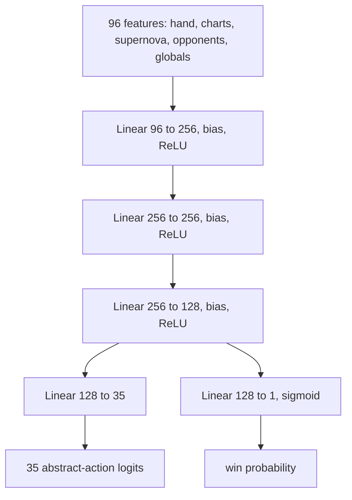

# 96-input MLP

Saved weights in `models/net.bin` and `models/rl.bin`. The layer sizes are the lengths of those weight vectors. This network has **128,164** parameters.

It is a feed-forward net over one game snapshot. The input is 96 floats, the first 96 of the later 104-feature vector. The last eight derived flags of that vector are not in this net.

## Input

One vector, `[f32; 96]`. No stacked history. The layout matches `encode_base` in `ml/src/feature.rs` up through the global block.

| Range | Count | Contents |
|---|---|---|
| 0..29 | 29 | My hand: count of each card type, divided by 3 |
| 29..41 | 12 | My star chart: complete and incomplete counts, a flag per star name, fill fraction, eclipse protection, approaching win |
| 41..48 | 7 | Per-star fill fraction of my incomplete systems |
| 48..52 | 4 | Supernova pieces in hand, and whether a supernova can be played now |
| 52..88 | 36 | Up to 3 opponents, 12 features each: hand size, chart counts, approaching win, eclipse, star-name flags |
| 88..96 | 8 | Deck size / 90, turn / 400, and the Dark Matter Void class flags |

## Body

Three linears, each with a bias, then ReLU.

1. `Linear(96 → 256)`
2. `Linear(256 → 256)`
3. `Linear(256 → 128)`

The third step changes width, so it has no skip. The weight file does not record whether the second layer adds its input back. The next network, which adds another 256-wide layer, does use those skips. This file only stores the matrices.

## Heads

Both heads read the 128-vector.

**Policy.** `Linear(128 → 35)`, no activation. The 35 logits are the abstract actions in `Overview.md` §3: Pass, six PlayStar, five PlayDiscovery, six PlaySolarSystem, five PlayFlare, PlaySupernovas, seven PlayFracture, two PlayProtostar, two PlayOmen. Illegal actions are masked before the softmax. The mask is a bit per action.

**Value.** `Linear(128 → 1)`, then sigmoid. One win probability for the seat that is deciding.

There is no candidate head. A concrete choice that shares an abstract action is not scored by a second network.

## Parameter count

| Piece | Parameters |
|---|---|
| Linear 96 → 256 | 24,832 |
| Linear 256 → 256 | 65,792 |
| Linear 256 → 128 | 32,896 |
| Policy 128 → 35 | 4,515 |
| Value 128 → 1 | 129 |
| **Total** | **128,164** |

A full-precision copy of the weights is 512,736 bytes, which is the size of both checkpoint files.
