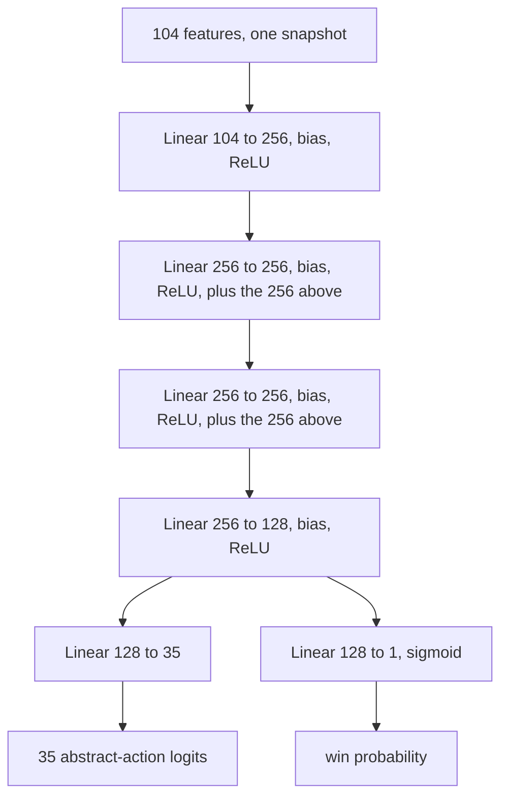

# v2 / v3 network

Saved weights in `models/net_v2.bin`, `models/rl_v2.bin`, `models/net_v3.bin`, `models/rl_v3.bin`, and `ml/models/net_v3.bin`. v2 and v3 are the same shape. Training differences are in `docs/ASTRA3.md`. This network has **196,004** parameters.

It is the residual MLP in `Overview.md` §4. One 104-float snapshot goes in. Two heads read a 128-float body.

## Input

One vector, `[f32; 104]`, from `encode_base` in `ml/src/feature.rs`. No stacked frames and no play history.

| Range | Count | Contents |
|---|---|---|
| 0..29 | 29 | My hand: count of each card type, divided by 3 |
| 29..41 | 12 | My star chart: complete and incomplete counts, a flag per star name, fill fraction, eclipse protection, approaching win |
| 41..48 | 7 | Per-star fill fraction of my incomplete systems |
| 48..52 | 4 | Supernova pieces in hand, and whether a supernova can be played now |
| 52..88 | 36 | Up to 3 opponents, 12 features each |
| 88..96 | 8 | Deck size / 90, turn / 400, Dark Matter Void class flags |
| 96..104 | 8 | Derived: my hand size / 7, am I active, opponent count / 3, best opponent complete-count / 3, one minus deck fraction, hand has 5 or more cards, am I leading, deck empty |

## Body

Four linears, each with a bias. He initialisation: standard deviation `sqrt(2 / fan_in)`. ReLU after each linear.

1. `Linear(104 → 256)`, then ReLU.
2. `Linear(256 → 256)`, add the previous 256, then ReLU.
3. `Linear(256 → 256)`, add the previous 256, then ReLU.
4. `Linear(256 → 128)`, then ReLU. The width changes, so this step has no skip.

The 128-vector is the body. Both heads read it, and nothing else.

## Heads

**Policy.** `Linear(128 → 35)`, no activation. The 35 logits are the abstract actions in `Overview.md` §3: Pass, six PlayStar, five PlayDiscovery, six PlaySolarSystem, five PlayFlare, PlaySupernovas, seven PlayFracture, two PlayProtostar, two PlayOmen. Illegal logits are removed by a bit mask before the softmax.

**Value.** `Linear(128 → 1)`, then sigmoid. One win probability for the deciding seat.

There is no candidate head. Several concrete plays share one of the 35 slots, and this net does not score those options itself.

## Parameter count

| Piece | Parameters |
|---|---|
| Linear 104 → 256 | 26,880 |
| Linear 256 → 256 | 65,792 |
| Linear 256 → 256 | 65,792 |
| Linear 256 → 128 | 32,896 |
| Policy 128 → 35 | 4,515 |
| Value 128 → 1 | 129 |
| **Total** | **196,004** |

A full-precision copy of the weights is 784,112 bytes, which is the size of each of these checkpoints. The skips add no parameters.
