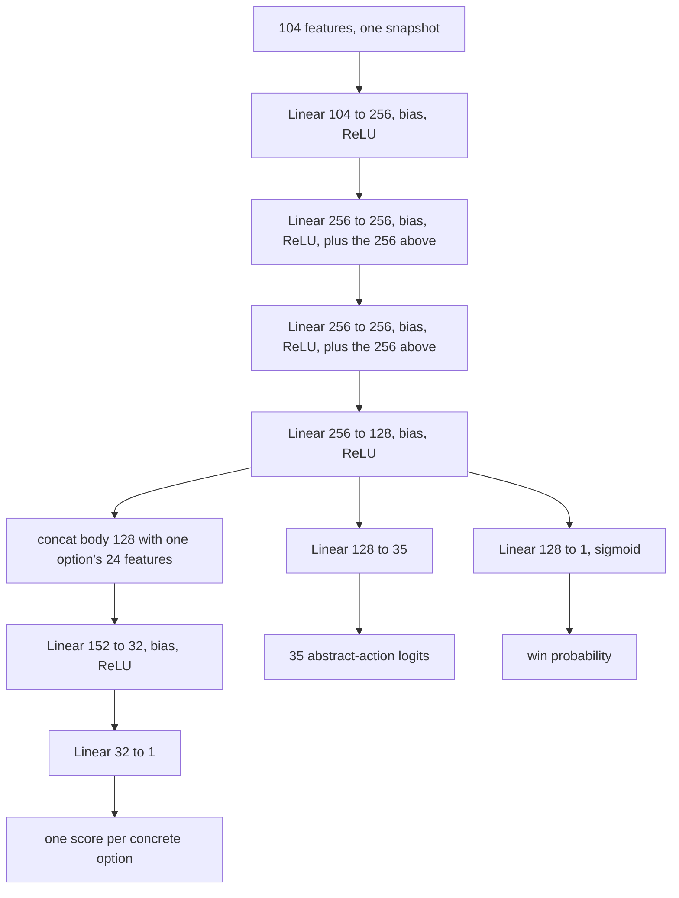

# v4 / v5 network

Saved weights in `models/net_v4.bin`, `models/rl_v4.bin`, `models/net_v5.bin`, and `models/rl_v5.bin`. v4 and v5 are the same shape. Training differences are in `docs/ASTRA5.md`. This network has **200,933** parameters.

The trunk is the v2 / v3 residual MLP. A third head scores concrete options. That head is the only addition: 4,929 of the parameters.

## Input

The trunk input is the same `[f32; 104]` snapshot as v2 / v3. See `docs/ASTRA2.md` for the feature table. There is still no stacked history.

Each concrete option is a separate 24-float vector, `Overview.md` §5:

| Range | Contents |
|---|---|
| 0..5 | Type flags: card, system, player, star class, chain link |
| 5..12 | Card features: type, and hand position |
| 12..17 | System features: completion, discoveries still needed |
| 17..20 | Player features: my complete systems, opponent pressure |
| 20..22 | Deck progress, turn progress |
| 22..24 | Slot index over the option count, and the option count / 10 |

The current 24-float encoder in `ml/src/candidate.rs` is the Astra-6 layout. These checkpoints were trained with the §5 layout above. The width is the same. The field meanings are not.

## Body

Same four linears as v2 / v3. Bias on every linear. He initialisation, `sqrt(2 / fan_in)`. ReLU after each linear. Skips on the two 256-wide layers. The 256 → 128 layer has no skip. The body is the 128-vector.

## Heads

**Policy.** `Linear(128 → 35)`. Same 35 abstract actions as v2 / v3. A bit mask drops illegal logits before the softmax. This head chooses the kind of play, not which concrete card or system.

**Value.** `Linear(128 → 1)`, then sigmoid.

**Candidate.** For each option, concatenate the 128-vector with that option's 24 floats, then:

1. `Linear(152 → 32)`, bias, ReLU.
2. `Linear(32 → 1)`, bias, no activation.

The same weights score every option. Softmax over those scores picks one. The head is used for discards, target picks, decide prompts, and for concrete plays that share one abstract action.

## Parameter count

| Piece | Parameters |
|---|---|
| Trunk, same as v2 / v3 through the 128-vector | 191,360 |
| Policy 128 → 35 | 4,515 |
| Value 128 → 1 | 129 |
| Candidate 152 → 32 | 4,896 |
| Candidate 32 → 1 | 33 |
| **Total** | **200,933** |

A full-precision copy of the weights is 803,860 bytes.
