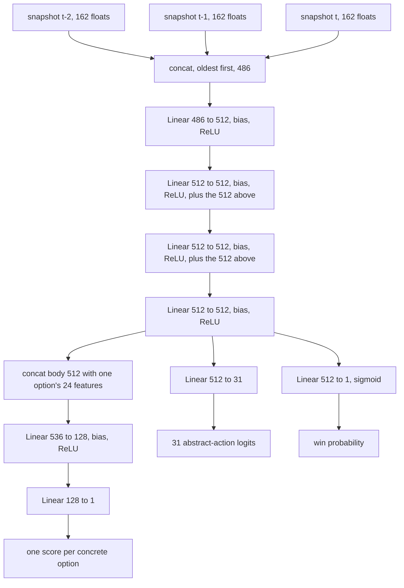

# Astra-6, wide candidate head

Saved weights: every `astra6_*.bin` in `ml/models/` except `astra6_v3_rl.bin`. That includes `astra6_v3_wide.bin`, the reinforce runs, and the v4, v5, and v6 AlphaZero runs, both the latest file and the `*_best.bin` sibling. This network has **1,122,593** parameters.

It is the net in `ml/src/net.rs`. The trunk matches `docs/ASTRA6.md`. The candidate hidden layer is 128 instead of 32.

## Input

Three snapshots concatenated, oldest first. Each is 162 floats from `encode` in `ml/src/feature.rs`. The stacked vector is `[f32; 486]`. Slots that do not exist yet are zeros.

| Range inside one snapshot | Count | Contents |
|---|---|---|
| 0..104 | 104 | Hand, charts, supernova, opponents, globals, derived flags |
| 104..124 | 20 | Last plays, 4 seats by 5 card categories, count / 5, clamped at 1 |
| 124..133 | 9 | Per opponent: flare, fracture, supernova already played |
| 133..162 | 29 | Discard pile, count of each card type / 3 |

## Body

`body_forward` in `ml/src/net.rs`. Bias on every linear. He initialisation, `sqrt(2 / fan_in)`. ReLU after each linear.

1. `Linear(486 → 512)`, then ReLU.
2. `Linear(512 → 512)`, add the previous 512, then ReLU.
3. `Linear(512 → 512)`, add the previous 512, then ReLU.
4. `Linear(512 → 512)`, then ReLU. No skip on this layer.

## Heads

**Policy.** `Linear(512 → 31)`. The index list is in `ml/src/action.rs` and in `docs/ASTRA6.md`. PlayDiscovery is one of the 31. The concrete discovery is a candidate-head choice. Illegal logits are masked before the softmax.

**Value.** `Linear(512 → 1)`, then sigmoid.

**Candidate.** Concatenate the 512 body with the 24-float option vector from `ml/src/candidate.rs`, then:

1. `Linear(536 → 128)`, bias, ReLU.
2. `Linear(128 → 1)`, bias, no activation.

The same weights score every option. Softmax over the scores picks the discard, the target, the decide option, or the concrete play when several plays share an abstract action.

The 24 fields:

| Range | Contents |
|---|---|
| 0..5 | Kind flags: hand card, system, player, star class, chain link |
| 5..12 | Card type / 28, kind flags, star class / 6 |
| 12..17 | System: star name, class, fill, would complete, eclipse |
| 17..20 | Player: relative seat, complete systems, approaching win |
| 20..22 | Star-class value, and whether the target is on an opponent chart |
| 22..24 | Option index and option count, each scaled |

## Parameter count

| Piece | Parameters |
|---|---|
| Linear 486 → 512 | 249,344 |
| Three linears 512 → 512 | 787,968 |
| Policy 512 → 31 | 15,903 |
| Value 512 → 1 | 513 |
| Candidate 536 → 128 | 68,736 |
| Candidate 128 → 1 | 129 |
| **Total** | **1,122,593** |

Against the narrow Astra-6 file, the trunk and the two main heads are unchanged. The candidate block grows from 17,217 parameters to 68,865. A full-precision copy of these weights is 4,490,500 bytes.
