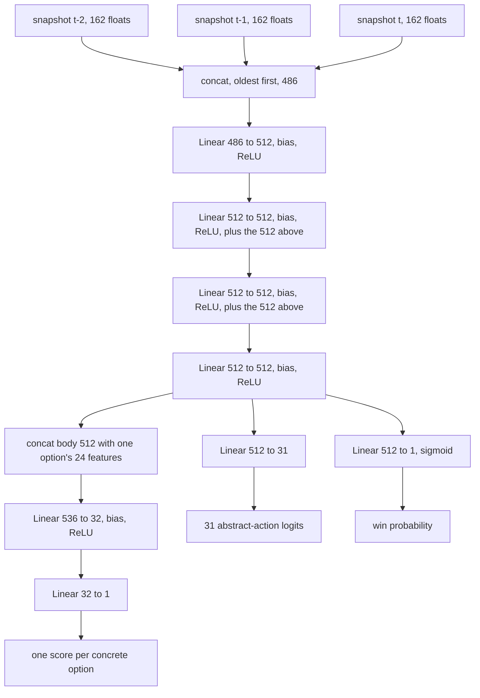

# Astra-6, narrow candidate head

Saved weights in `ml/models/astra6_v3_rl.bin` and in `ml/learning_curve_out/pretrain_1000.bin`, `pretrain_2000.bin`, `pretrain_4000.bin`, `pretrain_8000.bin`. This network has **1,070,945** parameters.

The code that matches the wider candidate head is `ml/src/net.rs`. This file is that net with the candidate hidden layer at 32 instead of 128. The trunk, the input, and both main heads are the same.

## Input

Three snapshots concatenated, oldest first, then the middle one, then the current one. `StateStack` in `ml/src/mcts.rs` shifts them that way. Before three decisions exist, the older slots are zeros. Each snapshot is the 162-float encoder in `ml/src/feature.rs`.

| Range inside one snapshot | Count | Contents |
|---|---|---|
| 0..104 | 104 | The v2 / v3 snapshot: hand, charts, supernova, opponents, globals, derived flags |
| 104..124 | 20 | Last plays, 4 seats by 5 card categories, count / 5 and clamped at 1 |
| 124..133 | 9 | Per opponent: has played a flare, a fracture, a supernova |
| 133..162 | 29 | Discard pile, count of each card type / 3 |

The stacked vector is `[f32; 486]`.

## Body

Four linears, each with a bias. He initialisation, `sqrt(2 / fan_in)`. ReLU after each linear. This is `body_forward` in `ml/src/net.rs`.

1. `Linear(486 → 512)`, then ReLU.
2. `Linear(512 → 512)`, add the previous 512, then ReLU.
3. `Linear(512 → 512)`, add the previous 512, then ReLU.
4. `Linear(512 → 512)`, then ReLU. Same width, and the code does not add a skip here.

The 512-vector is the body.

## Heads

**Policy.** `Linear(512 → 31)`, no activation. The 31 abstract actions are in `ml/src/action.rs`:

| Indices | Action |
|---|---|
| 0 | Pass |
| 1..7 | PlayStar, six star names, not Protostar |
| 7 | PlayDiscovery, one slot for every discovery |
| 8..14 | PlaySolarSystem, the same six stars |
| 14..19 | PlayFlare, five flares |
| 19 | PlaySupernovas |
| 20..27 | PlayFracture, seven fractures |
| 27..29 | PlayProtostar, draw two or search a white dwarf |
| 29..31 | PlayOmen, Solar Eclipse or Planet of Life |

Illegal logits are masked before the softmax. Discovery types are not separate policy outputs. The candidate head picks the concrete discovery.

**Value.** `Linear(512 → 1)`, then sigmoid.

**Candidate.** Concatenate the 512-vector with one option's 24 floats from `ml/src/candidate.rs`:

| Range | Contents |
|---|---|
| 0..5 | Kind flags: hand card, system, player, star class, chain link |
| 5..12 | Card type / 28, kind flags, star class / 6 |
| 12..17 | System: star name, class, fill, would complete, eclipse |
| 17..20 | Player: relative seat, complete systems, approaching win |
| 20..22 | Star-class value, and whether the target is on an opponent chart |
| 22..24 | Option index and option count, each scaled |

Then `Linear(536 → 32)`, ReLU, `Linear(32 → 1)`. One shared pair of linears scores every option. Softmax over the scores picks one. Used for discards, targets, decide prompts, and concrete plays that share an abstract action.

## Parameter count

| Piece | Parameters |
|---|---|
| Linear 486 → 512 | 249,344 |
| Three linears 512 → 512 | 787,968 |
| Policy 512 → 31 | 15,903 |
| Value 512 → 1 | 513 |
| Candidate 536 → 32 | 17,184 |
| Candidate 32 → 1 | 33 |
| **Total** | **1,070,945** |

A full-precision copy of the weights is 4,283,908 bytes. The two skips add no parameters.
