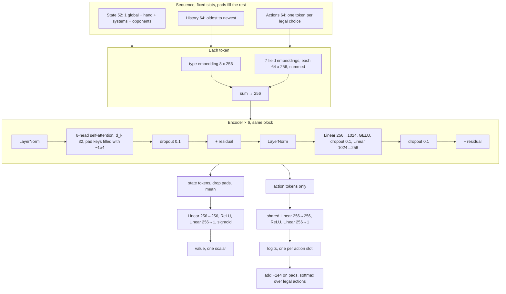

# Astra-7 network

Implemented net in `ml7/src/net.rs` and `ml7/src/tokens.rs`. This is the network as it runs, enough to draw it.

Astra-7 is a bidirectional encoder over a fixed 180-token game sequence, with two small readouts on top. It has **4,987,394** parameters. There is no decoder, no causal mask, and no positional-embedding table.

## Sequence

Every token is 8 bytes: a type id plus 7 field bytes. The logical layout is always three blocks, and pads occupy the unused slots. A batch may trim each block to the longest real token in that block, rounded up to a multiple of 8. The fields of a real token do not change when that happens.

| Block | Slots | Positions | What sits there |
|---|---|---|---|
| State | 52 | 0–51 | 1 global, then up to 12 hand cards, up to 9 of my systems, then up to 3 opponents each followed by up to 9 of their systems |
| History | 64 | 52–115 | Last 64 plays, oldest first |
| Actions | 64 | 116–179 | One token per legal choice for this decision |

`SEQ_LEN = 52 + 64 + 64 = 180`.

Types are `Pad`, `Global`, `HandCard`, `MySystem`, `OppSystem`, `Opponent`, `History`, `Action`. Field bytes are bucketed integers used as embedding rows, so every field is in `0..64`. History has no position embedding. Its recency is field 6, `0` for the oldest event kept. Seats are relative to the player who is deciding: `0` is me, `1..3` are the opponents in view order.

### Token fields

| Token | Fields |
|---|---|
| Global | deck-size bucket, turn bucket, dark-matter-void class, am-active |
| HandCard | card type (`0..29`), star class |
| MySystem / OppSystem | star name, class, discoveries filled, eclipse-protected, complete, owner slot (`0` = mine) |
| Opponent | slot, hand size, complete-system count, approaching win |
| History | event type (always `0` = play today), card type, relative seat, and field 6 = position from oldest to newest |
| Action | field 0 is the action kind (`Pass`, plays, chain response, decide, pick target, discard). The other fields carry the card, the target system, the hand slot, or the prompt, depending on the kind |

All five decision kinds share this one action-token shape. The decision kind lives in the token, not in a separate head.

## Embedding

One type table, 8 rows of 256. Seven field tables, 64 rows of 256 each. A token vector is the type row plus the seven field rows. Embeddings have no bias. The encoder then sees `[batch, length, 256]`.

## One encoder layer, repeated 6 times

Pre-norm, residual, dropout 0.1. Width 256, 8 heads, feed-forward 1024. There is no layer norm after the last block.

1. Layer-norm the residual stream, then multi-head self-attention, dropout, add back.
2. Layer-norm, then the feed-forward block, dropout, add back.

The feed-forward block is `Linear(256 → 1024) → GELU → dropout 0.1 → Linear(1024 → 256)`. Every linear has a bias. Layer-norm is `γ` and `β` on the last dimension. Its epsilon is `1e-5`, and `1e-4` on the Vulkan fp16 build.

Attention is bidirectional self-attention. Query, key, and value are the same sequence. Each of Q, K, V, and the output projection is a `256 → 256` linear. The head size is `256 / 8 = 32`, and the scores are divided by `√32` before softmax. A pad key is filled with `−1e4` and then the softmax runs over the key axis. There is no attention mask besides that pad mask, so a state token can attend to action tokens and history. Dropout 0.1 is applied to the scores before the pad fill. The softmax is the ordinary one.

Shapes inside one attention block: Q, K, and V are `[batch, 8, length, 32]`. Scores are `[batch, 8, length, length]`.

## Heads

Both heads read the encoder output. They do not see each other's activations.

**Policy.** Take the action block, `[batch, 64, 256]`. A shared MLP scores each token on its own: `Linear(256 → 256) → ReLU → Linear(256 → 1)`. That last layer is one learned vector dotted with the ReLU output, so the drawing is a per-token scorer, not a second attention block. Illegal slots are pad tokens. Callers add `−1e4` to those logits and take the softmax over however many legal actions exist. The training loss is cross-entropy on the chosen index, mixed with a uniform distribution over the legal set at label smoothing `0.05`.

**Value.** Mean-pool the state block, ignoring pads, to one 256-vector. Then `Linear(256 → 256) → ReLU → Linear(256 → 1) → sigmoid`. History and action tokens are not in that average. Their contents still affect it, because the state tokens have already attended to them. The current behavior-cloning target is the terminal outcome, `1` if this seat won and `0` otherwise, as mean squared error weighted by `0.3` and added to the policy loss.

Output shapes: policy logits `[batch, 64]`, value `[batch, 1]` in `(0, 1)`.

## Parameter count

| Piece | Parameters |
|---|---|
| Type embedding, 8 × 256 | 2,048 |
| Field embeddings, 7 × 64 × 256 | 114,688 |
| One encoder layer | 789,760 |
| Six encoder layers | 4,738,560 |
| Pointer head, 256→256→1 | 66,049 |
| Value head, 256→256→1 | 66,049 |
| **Total** | **4,987,394** |

One encoder layer is 4 attention linears (263,168), the feed-forward pair (525,568), and two layer-norms (1,024). A full-precision copy of the weights is 19.0 MiB. The Vulkan trainer stores them in fp16, about 9.5 MiB. The optimizer is Adam with global-norm gradient clipping at 1.0. On the Vulkan build its epsilon is `1e-2`.

The opponent-hand auxiliary head from `../ASTRA7.md` §3.2 is not in this network.
